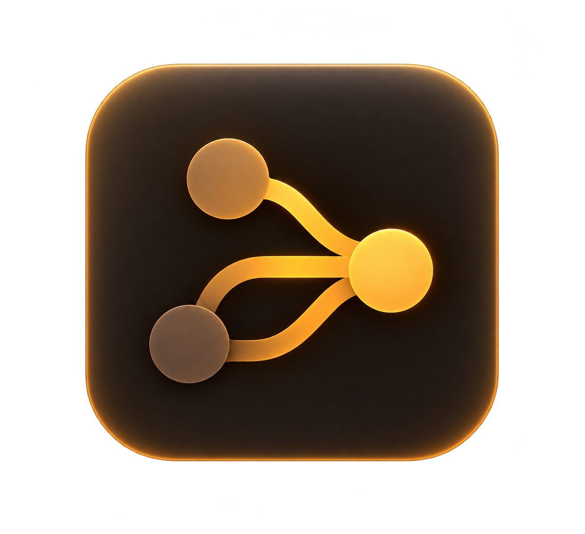
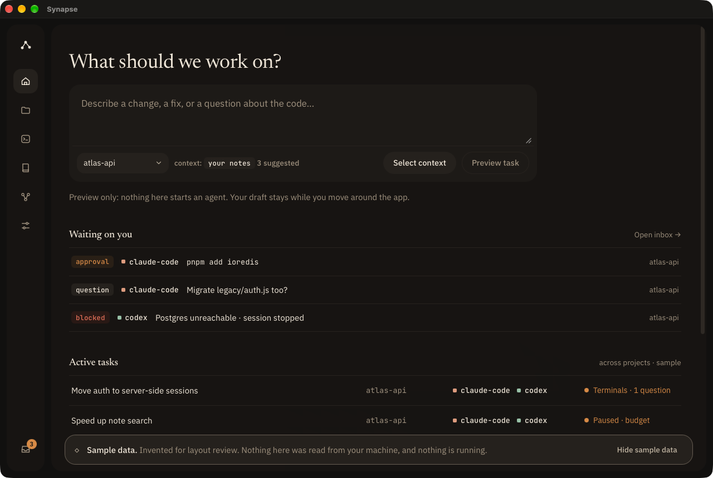
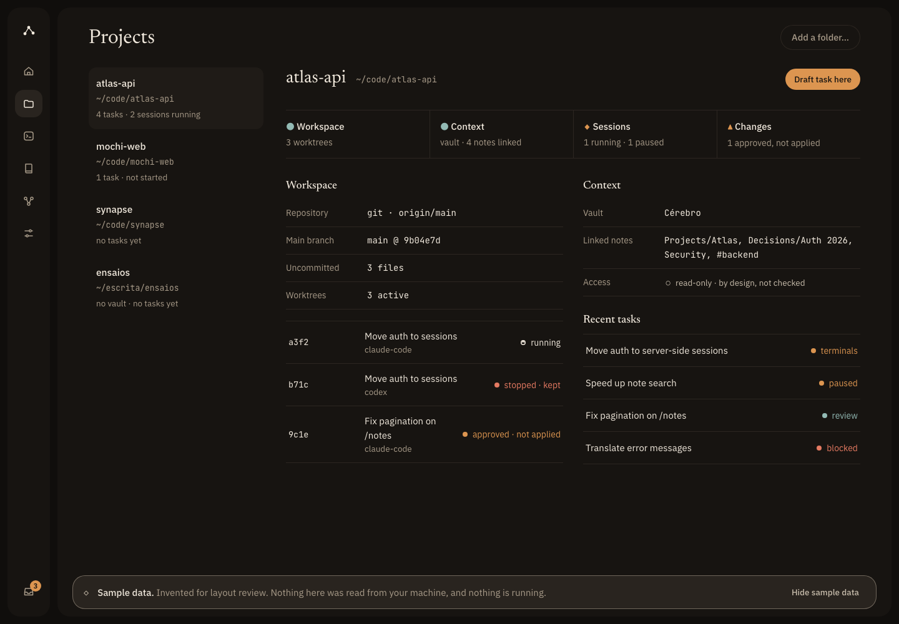
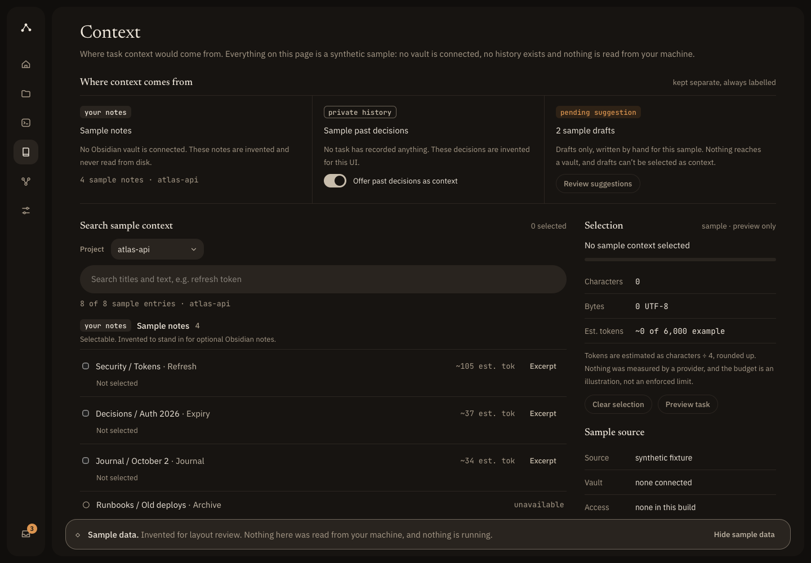
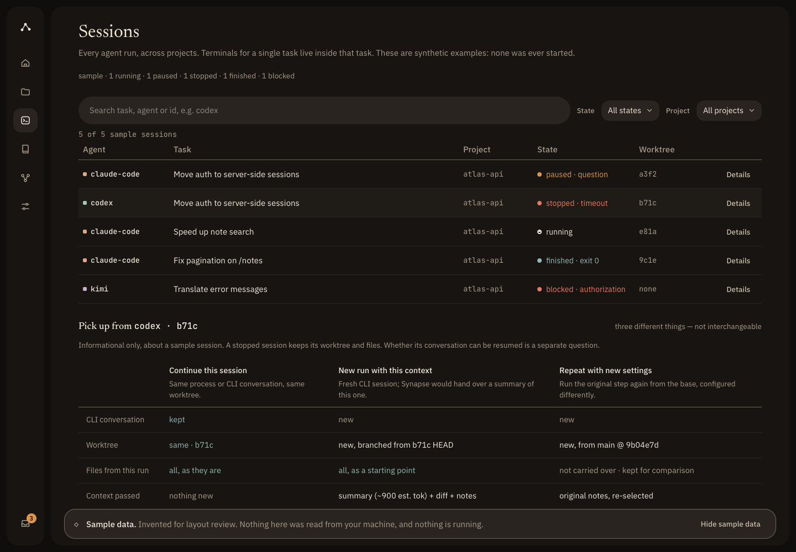

  

<h1 align="center">Synapse</h1>

A local-first workspace for AI coding agents.

Early development. The desktop app is an interface preview over sample data; it does not run agents yet.

  

<table align="center">
  <tr>
    <td width="33%"></td>
    <td width="33%"></td>
    <td width="33%"></td>
  </tr>
  <tr align="center">
    <td>Projects</td>
    <td>Context</td>
    <td>Sessions</td>
  </tr>
</table>

Early-development previews. Every project, task, note and session shown is invented sample data. Home is a capture of the native desktop window; Context and Sessions are Playwright WebKit renders and Projects is a headless Firefox render of the same production build, not the Tauri window. <a href="./docs/implementation/desktop-visual-verification.md">How each was captured</a>.

## Overview

Synapse is meant to become a desktop workspace where you describe a task, choose the notes and history an agent may see, and follow the agent sessions that carry it out, with your files and context staying on your machine.

Today only the interface exists. The desktop app, built with Tauri, React and TypeScript, lets you move between Home, Projects, Context and Sessions and draft a task preview. Orchestration, provider execution and any reading of your files or notes are future work.

## Current status

- **Implemented:** an interactive desktop shell with Home, Projects, Context and Sessions pages, and one native command whose only job is to prove that the IPC permission boundary is enforced.
- **Sample data and previews:** all content in the app is a synthetic fixture. Actions such as "Preview task" change nothing and start nothing.
- **Inherited foundations:** the MCO command-line runtime and a set of library-only safety components (probe authorization, an execution safety gate that currently always answers no). They are tested, but they are not connected to the desktop app and create no sandbox.
- **Not available:** running agents, calling providers, opening an Obsidian vault, or any real runtime integration from the desktop experience.

## Documentation

- [Run the desktop app, tests and build](./desktop/README.md#commands)
- [Desktop architecture](./docs/implementation/desktop-architecture.md), including [IPC authorization](./docs/implementation/desktop-architecture.md#ipc-authorization)
- [All documentation](./docs/README.md): roadmap, safety gate, screenshot provenance and the inherited MCO guides
- [Changelog](./CHANGELOG.md)

## Origins and license

Synapse began from [MCO](https://github.com/mco-org/mco), a CLI orchestration layer for AI coding agents by the mco maintainers, starting from its `v0.12.1` release, and is evolving into a separate product with its own desktop application. The inherited runtime and documentation remain in this repository. Thanks to the MCO authors; see the commit history for individual contributors.

Released under the MIT License. See [LICENSE](./LICENSE), which carries the original copyright notice (Copyright (c) 2026 mco maintainers).
